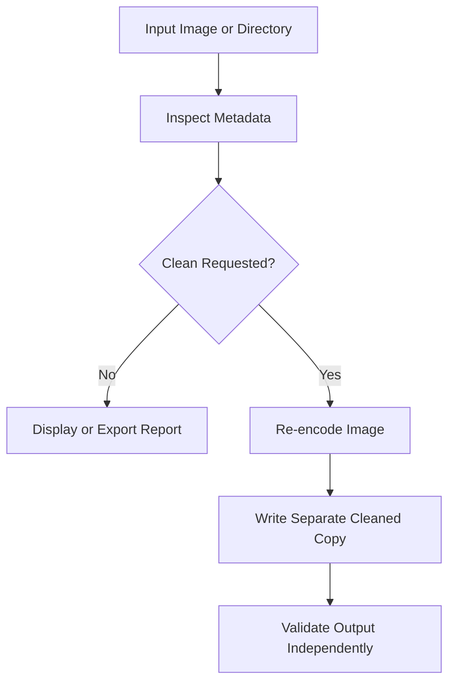

# imgmeta-cli

A cross-platform command-line tool to **inspect image metadata** and create a **metadata-cleaned copy** of an image.

Works on Windows Command Prompt, PowerShell, macOS, and Linux through Python.

## Features

- Inspect image format, dimensions, color mode, frame count, file size, SHA-256, EXIF tags, GPS fields (when available), and metadata exposed by Pillow.
- Remove EXIF and common embedded metadata by re-encoding an image.
- Process one image or a directory, with optional recursive processing.
- Keep the original unchanged; cleaned copies use the `_clean` suffix by default.
- Preserve an embedded ICC color profile by default; use `--no-icc` to remove it too.

## Supported Formats

JPEG, PNG, WebP, TIFF, and BMP. Feature support depends on the installed Pillow codecs and the source file.

## Requirements

- Python 3.9 or newer
- Pillow (installed automatically with the package)

## Installation

Clone the repository:

```bash
git clone https://github.com/Afternoon11/Image-MetaData-Remover.git
cd Image-MetaData-Remover
python -m venv .venv
```

Activate the environment:

**Windows CMD**
```bat
.venv\\Scripts\\activate.bat
```

**Windows PowerShell**
```powershell
.venv\\Scripts\\Activate.ps1
```

**Linux / macOS**
```bash
source .venv/bin/activate
```

Install the project:

```bash
python -m pip install --upgrade pip
python -m pip install -e .
```

You can now run `imgmeta` from the activated environment.

## Usage

### View metadata

```bash
imgmeta view photo.jpg
```

Save the report as JSON:

```bash
imgmeta view photo.jpg --output report.json
```

### Remove metadata

Create `photo_clean.jpg` beside the original:

```bash
imgmeta clean photo.jpg
```

Choose an output filename:

```bash
imgmeta clean photo.jpg --output cleaned.jpg
```

Choose an output directory:

```bash
imgmeta clean photo.jpg --output cleaned_images/
```

Remove the ICC color profile too:

```bash
imgmeta clean photo.jpg --no-icc
```

### Batch clean a directory

```bash
imgmeta clean ./photos --output ./cleaned
imgmeta clean ./photos --recursive --output ./cleaned
```

On Windows, paths can be quoted:

```bat
imgmeta clean "C:\\Users\\You\\Pictures" --recursive --output "C:\\Users\\You\\Pictures\\cleaned"
```

If an output file already exists, the tool refuses to overwrite it. Add `--overwrite` only when replacement is intentional.

### Help and version

```bash
imgmeta --help
imgmeta view --help
imgmeta clean --help
imgmeta --version
```

## Important Behavior and Limitations

- The source image is not modified. The tool writes a new output file unless you explicitly use `--overwrite`.
- Metadata removal is performed by decoding and re-encoding; it is not a byte-for-byte metadata deletion.
- JPEG is lossy: cleaning re-encodes JPEG at quality 95, so pixel data may change slightly. Keep a backup if exact image preservation matters.
- Animated WebP handling depends on Pillow's installed codec support. Verify output before deleting originals.
- ICC profiles are retained by default because they affect color rendering. Use `--no-icc` to remove them too.
- The viewer reports metadata Pillow exposes. Vendor-specific, proprietary, sidecar, filesystem, or container-level data may not be displayed.
- The tool does not guarantee that every possible metadata block is removed from every file variant. For forensic-grade sanitization, validate outputs independently with a tool such as ExifTool.
- Never rely on metadata removal as the only privacy protection before publishing sensitive images.

## Development

```bash
python -m pip install -e .
python -m imgmeta --help
```

## License

MIT. See [LICENSE](LICENSE).


## Processing Workflow


